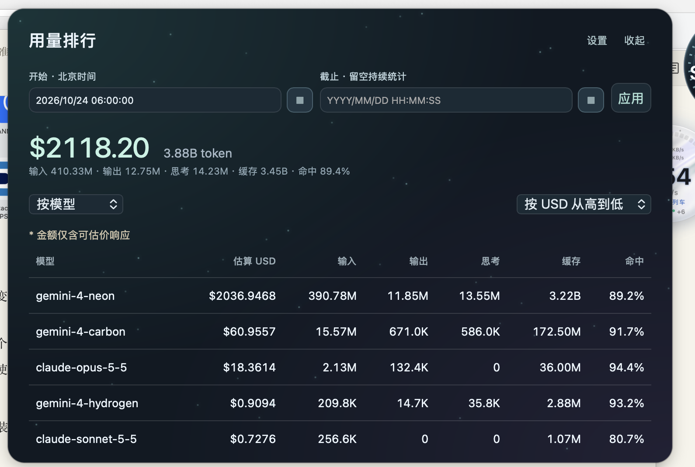
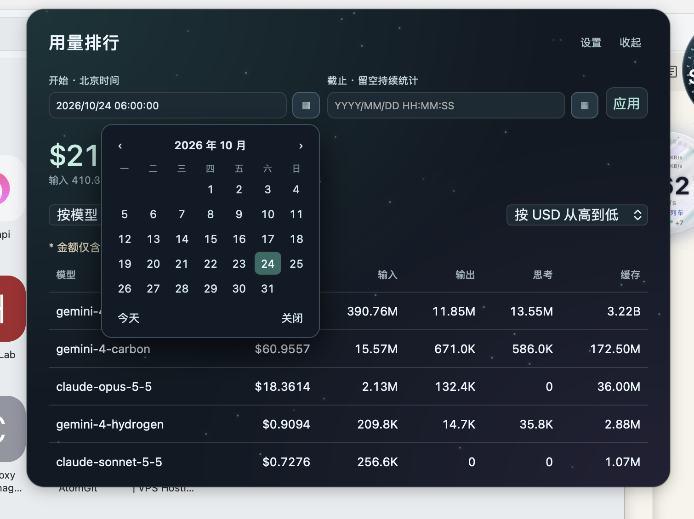

# 本地增强说明（fork）

在 [@QianqiuerQS/antigravity-usage](https://github.com/QianqiuerQS/antigravity-usage) v1.0.1 基础上做的本地增强，
主要面向 macOS 悬浮球和「用量排行」面板。

## 功能

- **单击即开排行**：单击悬浮球直接打开用量排行；点面板外、切到别的 App 会自动收起，再次单击可重新打开。
- **设置入口**：面板右上角「设置」可改统计起点、从现在开始或退出；设置面板在切换 App 时会自动折叠。
- **时间可编辑到秒**：开始/截止时间支持 `YYYY/MM/DD HH:MM:SS` 文本（秒可省略，`-` 或 `/` 分隔），
  失焦自动规范化；非法日期会提示。
- **月历选择**：每个时间框右侧的 ▦ 打开自绘月历，可翻月、选「今天」；选中日期会保留原时分秒并立即生效。
- **token 单位**：K / M / B，超过 1000M 进位为 B；悬停可见精确值。
- **token 拆分**：输入 / 输出（回复）/ 思考 / 缓存四列，总量 = 四者之和。
- **缓存命中率**：每行和汇总都显示 `缓存读取 / (输入 + 缓存读取)`。
- **稳定性**：读取 `conversation_summaries.db`（WAL）失败时重试并退化为 `immutable=1` 快照，
  避免线程标题整批丢失。

## 数据口径

本地只读 `~/.gemini/antigravity/conversations/*.db` 的 `steps.metadata`，usage 字段（protobuf）含义：

| 列 | 含义 | 字段号 |
|---|---|---|
| 输入 | 未命中缓存的输入 token | 2 |
| 输出 | 回复 token（不含思考） | 3 − 9 |
| 思考 | 思考 token | 9 |
| 缓存 | 缓存读取 token | 5 |

- 每步另有两个固定开销字段（约 1.4K / 26，含义未公开、数值极小），未计入。
- 缓存写入字段在现有记录里恒为 0，命中率只按「读缓存 vs 未缓存输入」计算。
- 金额按 `index.html` 内置牌价折算，是 API 等价参考价，不是实际账单；时间按北京时间（UTC+8）切分。
- 依赖 Antigravity 本地库字段，客户端大版本更新后可能失效。

## 构建（macOS 13+）

```bash
python3.12 -m venv .venv
.venv/bin/pip install pyinstaller==6.16.0

.venv/bin/python -m PyInstaller --noconfirm --onefile --name UsageBackend \
  --add-data "$PWD/index.html:." --specpath build --workpath build/work --distpath build/dist app.py

xcrun swiftc -O -target arm64-apple-macos13.0 Orb.swift -o build/UsageOrb
```

组装 `Antigravity Usage.app`：`Contents/MacOS/{UsageOrb,UsageBackend}`、`Contents/Resources/{app.py,index.html}`，
`Info.plist` 用 `packaging/Info.plist` 并补 `CFBundleShortVersionString` / `LSMinimumSystemVersion`，
最后 `codesign --force --sign - "Antigravity Usage.app"`。Intel Mac 把 target 换成 `x86_64-apple-macos13.0`。

## 截图




